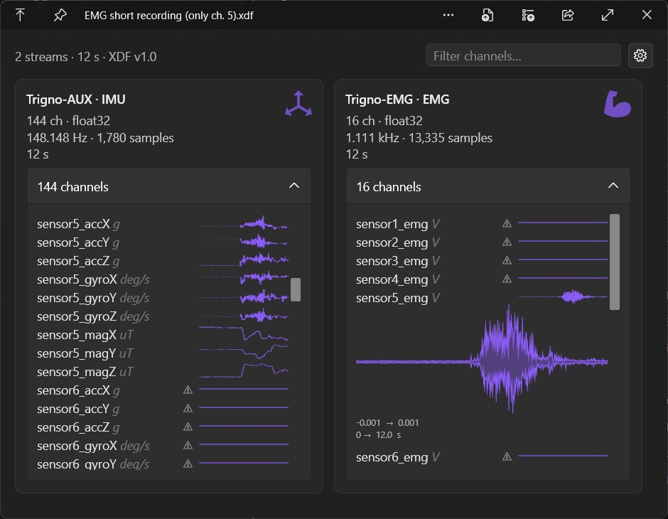
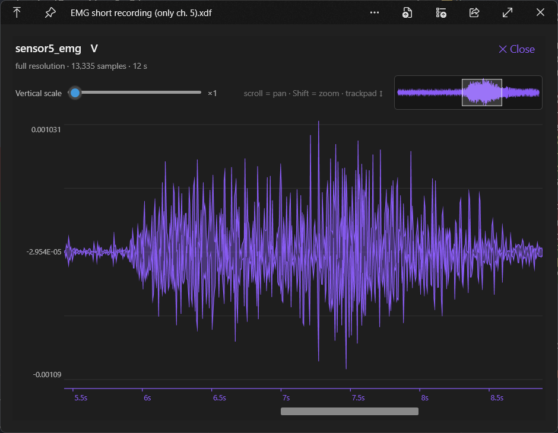

# QuickLook.Plugin.XdfViewer

[](LICENSE)

A [QuickLook](https://github.com/QL-Win/QuickLook) plugin that previews **XDF**
(Extensible Data Format) recordings — the format written by
[**LabRecorder**](https://github.com/labstreaminglayer/App-LabRecorder), the
standard recorder for **Lab Streaming Layer (LSL)** multi-stream data. Press
Space in Explorer on a `.xdf` file to get an instant, high-level overview of
every stream (EEG, ECG, EMG, respiration, accelerometer, markers, and more),
plus zoomable per-channel waveforms — without loading the raw sample data up
front.





## Features

- **Instant overview** — one card per stream (name · type, channels · format, rate ·
  samples, duration). The structural parse is cheap, so the overview appears
  immediately; sample decoding happens afterwards and never blocks it.
- **Per-stream-type icons** — EEG, ECG, EMG, EOG, respiration, GSR, PPG, heart rate,
  accelerometer, gyroscope, magnetometer, gaze, motion capture, NIRS, audio, video,
  markers, force, and temperature streams are each recognized and iconified at a
  glance.
- **Inline sparklines** for every numeric channel, with a larger decimated plot on
  click and a **full-window, zoomable view** on a second click.
- **Zoom to individual samples** — wheel zoom anchored on the cursor, four ways to
  pan (wheel / drag / minimap / scrollbar), a minimap navigator, time and amplitude
  axes, a vertical-scale slider, and a "sample-accurate" badge.
- **Hover crosshair** with a time + amplitude readout under the pointer.
- **Marker overlay** — marker-stream events drawn as vertical lines on the full view,
  switchable between **Off / Lines / Labels**.
- **Channel search** — filter channels by name across every stream, for recordings
  with 100+ channels (e.g. a 144-channel Trigno EMG stream).
- **Flat-channel warning** (grey ⚠) for constant/dead channels, and an
  **incomplete** badge for recordings that were cut short mid-capture.
- **Bounded cost** — decimated reads, windowed re-reads of only the visible range,
  and a chunk index built once, so memory and load time stay flat regardless of
  recording size.
- **Theme-aware** — legible in both light and dark QuickLook/Windows themes.

## Download

Grab the latest `QuickLook.Plugin.XdfViewer.qlplugin` from the
[**Releases**](../../releases) page, then open it with QuickLook (see [Install](#install)).

## Build from source

```
git clone --recursive https://github.com/<your-user>/QuickLook.Plugin.XdfViewer.git
dotnet build QuickLook.Plugin.XdfViewer.csproj -c Release
pwsh Scripts/pack-zip.ps1 -Configuration Release
```

`--recursive` is required (the `QuickLook.Common` submodule). Produces
`QuickLook.Plugin.XdfViewer.qlplugin`.

## Channel waveforms

Each numeric channel gets an inline min/max sparkline in its channel row, so
you can see roughly what the signal looks like without opening a full plotting
tool. Click a channel row to expand it into a larger, decimated waveform plot
with amplitude and time-range labels.

Waveform data is read with a bounded, approximate strided pass over the file —
independent of (and after) the instant structural overview, so the preview
window, stream/channel list, and summary bar always appear immediately and are
never blocked waiting on sample decoding. Very large streams are decimated
(strided sampling into a fixed bucket count) rather than fully decoded, so
memory and load time stay bounded regardless of recording size. Marker
streams are event streams, not waveforms, so their rows show timestamps/values
and no sparkline.

### Full-window view (zoomable)

Click the expanded plot again to open a full-window view of that single
channel — a windowed signal viewer:

- **Zoom:** mouse wheel zooms in/out, anchored on the cursor, all the way down
  to individual samples. **Pan:** Shift+wheel (or a horizontal trackpad swipe),
  click-and-drag on the plot, dragging the viewport box on the top-right
  **minimap**, or the horizontal **scrollbar** — all kept in sync.
- **Sample-accurate:** once the zoom reaches roughly one sample per few pixels
  the band switches to discrete **sample dots** and a "sample-accurate" badge
  appears, so it's obvious you're looking at real samples rather than a min/max
  envelope.
- **Vertical scale:** the slider amplifies amplitude about a robust baseline;
  the amplitude (Y) axis and baseline stay fixed while you pan, and the time
  (X) axis relabels for the visible window.

Only the **visible window** is decoded on each zoom/pan (a debounced,
sub-range read), so panning/zooming stays responsive even on large recordings;
a transient scale gives instant feedback until the crisp read lands. The
Pass-1 chunk index is built once and reused across every interaction, so the
whole file is never re-scanned per action. (One known limit: a stream written
as a single enormous `Samples` chunk must be decoded from the chunk start —
uncommon, since LabRecorder chunks periodically.)

## Markers & channel search

Marker-stream events can be drawn over the full-window plot as vertical lines, so
you can see where events fall relative to the signal. The **Markers** selector in
the settings row switches between:

| Mode | Shows |
|---|---|
| **Off** | nothing |
| **Lines** | a vertical line + caret per event (default) |
| **Labels** | the same, plus each event's value as a label |

Events are placed relative to the **selected stream's own first timestamp**. Raw LSL
clock values are used as-is (no cross-stream `ClockOffset` correction — overkill for a
preview), and if a stream has no usable first timestamp the overlay is suppressed
rather than drawn in the wrong place. The selector is hidden for files with no events.

The **search box** in the top-right filters channel rows by name across every stream
card — useful for finding one channel in a 144-channel recording. Cards stay in
place and show "no matching channels" when everything in them is filtered out;
marker streams are unaffected.

## Shortcuts

**Overview**

| Input | Action |
|---|---|
| Click a channel row | Expand/collapse its inline waveform |
| Click the expanded plot | Open the full-window zoom view |
| Type in the search box (top-right) | Filter channels by name |

**Full-window view**

| Input | Action |
|---|---|
| Mouse wheel | Pan (mouse) |
| Shift + wheel | Zoom about the cursor (mouse) |
| Trackpad ↕ / ↔ | Zoom / pan (Shift flips it) |
| Click + drag | Pan |
| Drag the minimap box | Pan |
| Horizontal scrollbar | Pan |
| **Double-click** | Reset — zoom fully out + vertical scale ×1 |
| **Home** / **End** | Jump to the start / end of the stream |
| **Esc** | Close the full-window view |
| Hover | Crosshair with time + amplitude readout |
| Vertical scale slider | Amplitude gain about the baseline |
| Markers selector | Off / Lines / Labels |

## Install

Open the `.qlplugin` with QuickLook (Space on the file), or drop it into
`%LocalAppData%\Programs\QuickLook\...\Plugins\` per the QuickLook docs, then
restart QuickLook.

## Manual verification checklist (developer runs this)

1. Press Space on a `.xdf` file in Explorer.
2. Expect: filename + summary bar (`N streams · <duration> · XDF v1.0`) and one
   card per stream.
3. Each card shows `name · type`, `channels · format`, `rate · samples`, duration.
4. Expand a data-stream card → channel labels/units (scrolls for 100+ channels).
5. Expand a marker-stream card → event timestamps + values.
6. A recording that crashed mid-capture shows an **incomplete** badge and still
   lists sample counts.
7. The stream/channel overview appears instantly; per-channel sparklines then
   fill in shortly after, without the overview ever appearing to stall.
8. Click a numeric channel row → a larger decimated waveform plot expands,
   labeled with amplitude and time range.
9. Sparklines and expanded plots are legible in both dark and light
   Windows/QuickLook themes.
10. A 144-channel EMG (e.g. Trigno) stream scrolls smoothly with sparklines
    rendered per row.
11. Click the expanded plot → full-window view opens with top/bottom padding,
    a minimap (top-right), a time axis, and an amplitude axis.
12. Mouse wheel zooms about the cursor; Shift+wheel, click-drag, minimap drag,
    and the scrollbar all pan, staying in sync. Zoom in far enough → sample
    dots + a "sample-accurate" badge appear.
13. On a large recording the full view stays responsive while zooming/panning
    (instant feedback, then a crisp redraw a beat later).
14. Cards fill the preview window — no dead strip on the right or below — and
    re-flow to fewer/more columns as the window is resized.
15. Hovering the full-view plot shows a crosshair whose readout tracks the pointer
    (time relative to the stream start, plus amplitude and unit).
16. **Esc** closes the full view; **Home**/**End** jump to the start/end keeping the
    zoom width; **double-click** resets to fully zoomed out at vertical scale ×1.
17. On a file with a marker stream, the **Markers** selector draws vertical event
    lines (Lines) and event values (Labels), and removes them (Off). Lines line up
    with the events listed on the marker-stream card. The selector is absent for
    files without events.
18. Typing in the top-right search box filters channel rows across all cards;
    clearing it restores them. A query matching nothing shows "no matching
    channels" on the affected cards, and marker cards are unaffected.

## Test

```
dotnet test QuickLook.Plugin.XdfViewer.Tests -c Debug
```

## License

[MIT](LICENSE) © nielsr2.
